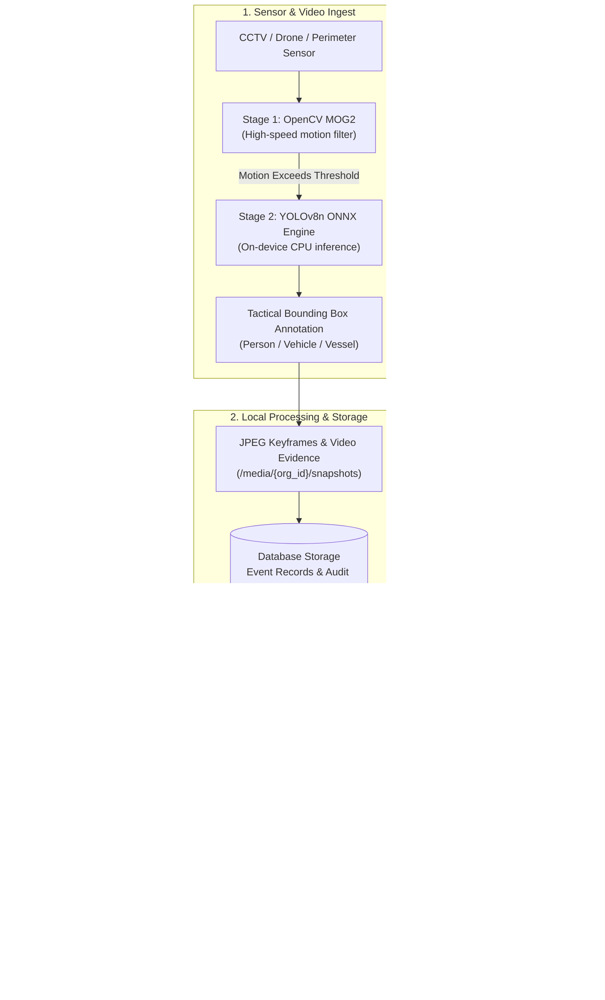

# Sentinel BD — Local-First Sensor Intelligence Platform

<p align="center">
  
  
  
</p>

<p align="center">
  
  
  
  
  
  
  
</p>

---

## 🎯 Executive Overview

**Sentinel BD** is a **100% cloud-free, local-first sensor intelligence and perimeter security platform** that combines on-device Edge AI, automated video motion analysis, real-time WebSocket alert broadcasting, and interactive tactical GIS mapping to empower security operators with rapid, auditable situational awareness.

All telemetry, video footage, AI models, and audit logs stay strictly inside your physical deployment infrastructure—guaranteeing **complete data sovereignty and zero external cloud dependency**.

> [!IMPORTANT]
> **Ethical & Operational Boundary:** Sentinel BD is an auditable **human-in-the-loop decision assistant**. It is **not** an autonomous weapon, targeting system, or interceptor controller. All motion scores and AI tags are supporting evidence; decisions remain human-verified and auditable.

---

## ⚡ Core Features & Capabilities



### 🧠 1. Local Edge AI Object Detection (YOLOv8n ONNX)
- **Zero Cloud Reliance:** Pure on-premise execution via `onnxruntime` CPU provider (12.2 MB quantized model).
- **Target Detection:** Classifies 80 COCO classes with specific surveillance focus on `person` (intruders), `car`/`truck`/`bus`/`motorcycle` (vehicles), and `boat`/`airplane` (vessels/aircraft).
- **Tactical Visual Annotations:** Automatically renders high-contrast bounding boxes with confidence scores (e.g., `PERSON 90%`, `CAR 85%`) directly onto extracted keyframes.
- **Fail-Safe Fallback:** Operates gracefully with contour motion subtraction if the AI model is offline.

### 🔔 2. Real-Time WebSockets & Tactical Audio Chimes
- **Instant Incident Push:** Backend worker instantly dispatches `NEW_ALERT` messages across `/api/v1/ws/alerts` using multi-tenant channel isolation.
- **Synthesized Tactical Chimes:** Plays a dual-frequency ascending sonar alert (880Hz → 1320Hz) via the browser Web Audio API—zero audio asset dependencies, guaranteed offline reliability.
- **Floating Crisis Toasts:** High-priority floating alert banner allows operators to jump directly to evidence inspection with a single click.

### 🗺️ 3. Interactive Tactical GIS Radar Map
- **Sector Situational Awareness:** High-contrast tactical radar dashboard (`/map`) visualizing monitoring sites, sensor radii, and incident locations.
- **Live Incident Pings:** Animated pulsating alerts pinpoint real-time intrusions across geographic coordinates.
- **Inspector Drawer:** Clickable map markers open immediate visual keyframes, detection metadata, and direct review links.

### 🎞️ 4. Visual Evidence Player & Jump-to-Motion
- **Synchronized Video Player:** Event review pages (`/events/[id]`) feature dual Keyframe / Source Video tabs.
- **Seek to Motion:** One-click "Jump to motion" button seeks HTML5 video playback directly to the exact millisecond of detected activity (`frame_timestamp_seconds`).
- **Media Auth Tokens:** Authenticated streaming support via `?token=` query fallback enables native `<video src>` and `` rendering without memory bloat.

### 🛡️ 5. Zero-Trust Security & Multi-Tenancy
- **Strict Tenant Isolation:** All SQL queries and storage directories enforce strict `organization_id` scoping.
- **Role-Based Access Control (RBAC):** Distinct permissions for `admin`, `operator`, `reviewer`, and `auditor`.
- **Worker Heartbeat & Fast Recovery:** 90-second worker lease timeouts automatically requeue jobs if a node restarts.
- **Immutable Audit Trail:** Forensic logs for all logins, user updates, event queries, and review verdicts.

---

## 📊 Automated Test Coverage (63/63 Passing)

Sentinel BD includes comprehensive unit and integration test coverage across the entire stack:

```text
============================= test session starts =============================
platform win32 -- Python 3.12.10, pytest-8.4.2, pluggy-1.6.0
collected 63 items

backend/tests/test_ai_detection.py ....                                  [  6%]
backend/tests/test_audit_and_headers.py ...                               [ 11%]
backend/tests/test_auth.py ..........                                     [ 26%]
backend/tests/test_devices_sites.py .......                               [ 38%]
backend/tests/test_events.py ............                                 [ 57%]
backend/tests/test_jobs.py ..............                                 [ 79%]
backend/tests/test_security.py .....                                      [ 87%]
backend/tests/test_ws.py ...                                              [ 92%]
backend/tests/test_users.py .....                                         [100%]

======================== 63 passed in 70.98s ========================
```

---

## 🚀 Quick Start Guide

### Prerequisites
- **Python:** `3.12+`
- **Node.js:** `v22+` / `v24+` and `npm`

---

### Step 1: Clone & Configure

```bash
git clone https://github.com/raitulh/Sentinel-BD.git
cd Sentinel-BD
```

---

### Step 2: Initialize Database & Seed Demo User

```powershell
# Windows PowerShell
$env:APP_ENV = "development"
$env:ALLOW_DEMO_SEED = "true"
$env:DATABASE_URL = "sqlite:///./sentinel.db"
$env:DEMO_EMAIL = "admin@sentinel.bd"
$env:DEMO_PASSWORD = "AdminPassword123!"

python backend/scripts/seed_demo.py
```

---

### Step 3: Start the Backend API Server (Port 8000)

```powershell
$env:APP_ENV = "development"
$env:SECRET_KEY = "0123456789abcdef0123456789abcdef0123456789abcdef0123456789abcdef"
$env:BOOTSTRAP_TOKEN = "abcdef0123456789abcdef0123456789abcdef01"
$env:DATABASE_URL = "sqlite:///./sentinel.db"
$env:MEDIA_ROOT = "./data/media"
$env:PYTHONPATH = "backend"

python -m uvicorn app.main:app --host 127.0.0.1 --port 8000
```
- API Liveness: `http://127.0.0.1:8000/health/live`
- API Readiness: `http://127.0.0.1:8000/health/ready`
- WebSocket Alerts: `ws://127.0.0.1:8000/api/v1/ws/alerts`

---

### Step 4: Start the Video AI Worker (Separate Terminal)

```powershell
$env:APP_ENV = "development"
$env:SECRET_KEY = "0123456789abcdef0123456789abcdef0123456789abcdef0123456789abcdef"
$env:DATABASE_URL = "sqlite:///./sentinel.db"
$env:MEDIA_ROOT = "./data/media"
$env:PYTHONPATH = "backend"

python -m app.worker
```

---

### Step 5: Start the Next.js Frontend Dashboard (Port 3000)

```bash
cd apps/web
npm install
$env:NEXT_PUBLIC_API_BASE_URL = "http://127.0.0.1:8000/api/v1"
npm run dev
```

Open your browser at **[http://127.0.0.1:3000/login](http://127.0.0.1:3000/login)**:
- **Email:** `admin@sentinel.bd`
- **Password:** `AdminPassword123!`

---

## 📡 API & WebSocket Reference

All business routes are prefixed under `/api/v1`:

| Route | Method | Description | Role Required |
|---|---|---|---|
| `/api/v1/auth/bootstrap` | `POST` | One-time initial admin setup | Bootstrap Token |
| `/api/v1/auth/login` | `POST` | Authenticate and obtain JWT token | Public |
| `/api/v1/ws/alerts` | `WEBSOCKET` | Real-time incident broadcast stream | Authenticated |
| `/api/v1/sites` | `GET`, `POST` | Manage monitored sectors & coordinates | Authenticated |
| `/api/v1/devices` | `GET`, `POST` | Sensor & CCTV registry | Authenticated |
| `/api/v1/devices/{id}/heartbeat`| `POST` | Device telemetry & health ping | Operator+ |
| `/api/v1/events` | `GET`, `POST` | Query, filter, and ingest sensor events | Authenticated |
| `/api/v1/events/{id}/snapshot` | `GET` | Stream annotated visual keyframe JPEG | Authenticated |
| `/api/v1/events/{id}/video` | `GET` | Stream source footage video clip | Authenticated |
| `/api/v1/events/{id}/reviews` | `GET`, `POST` | Record auditable human review verdict | Reviewer+ |
| `/api/v1/analysis/jobs` | `GET`, `POST` | Upload video for background AI analysis | Operator+ |
| `/api/v1/users` | `GET`, `POST` | Team user management & active status | Admin |
| `/api/v1/audit` | `GET` | Comprehensive forensic audit log | Admin / Auditor |

---

## 🏛️ Project Directory Structure

```text
sentinel-bd/
├── apps/
│   └── web/                   # Next.js 16 Web Dashboard (React 19, TypeScript)
│       ├── app/
│       │   ├── audit/         # Audit log explorer
│       │   ├── devices/       # Device & site registry
│       │   ├── events/        # Event table & visual review ([id])
│       │   ├── jobs/          # Video job upload & monitoring
│       │   ├── map/           # Tactical GIS Radar Map
│       │   └── users/         # User administration
│       └── components/        # AppShell, Web Audio API chime, AuthProvider
├── backend/
│   ├── app/
│   │   ├── ai/                # YOLOv8n ONNX Detector, Letterboxing & NMS
│   │   │   ├── models/        # Local yolov8n.onnx model weight
│   │   │   └── detector.py    # ONNX runtime inference service
│   │   ├── api/               # FastAPI routers (auth, events, ws, etc.)
│   │   ├── core/              # Config, Security, WebSocket Manager
│   │   ├── services/          # Video analyzer & background job coordinator
│   │   ├── models.py          # SQLAlchemy ORM models
│   │   └── worker.py          # Standalone background processing worker
│   ├── scripts/               # Seeding and administration scripts
│   └── tests/                 # 63 automated tests (pytest)
├── compose.yaml               # Docker Compose deployment definition
└── README.md                  # Project documentation
```

---

## ⚖️ License & Ethical Declaration

Distributed under the **Apache License 2.0**.

**Operational Statement:** Sentinel BD is engineered exclusively as a defensive sensor intelligence and human-centric monitoring assistant. It does not contain any targeting, interceptor guidance, electronic jamming, or autonomous weapon-engagement algorithms. All analytical outputs require human evaluation prior to any operational response.
